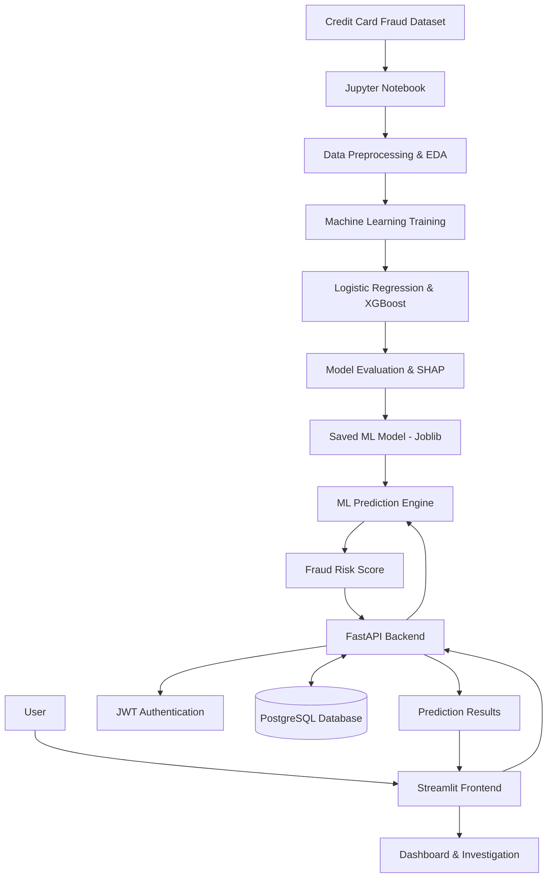
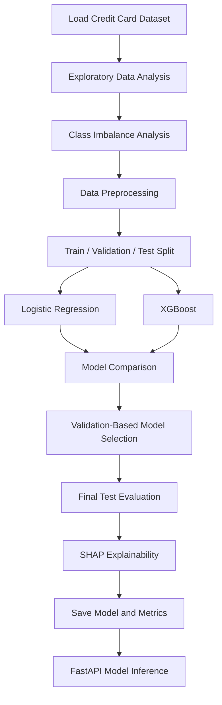

# 🛡️ FraudShield AI

### Explainable Credit Card Fraud Detection & Investigation Platform


**FraudShield AI** is an end-to-end Machine Learning application that analyzes credit card transactions, estimates fraud risk, and helps users review potentially suspicious activity.

The platform combines **Machine Learning, Explainable AI, FastAPI, Streamlit, PostgreSQL, and Docker** to create a full-stack fraud detection and investigation system.

Users can register, log in, upload transactions, generate fraud risk scores, monitor suspicious activity, and access their individual prediction history.

All Machine Learning experimentation, including EDA, preprocessing, training, testing, and SHAP analysis, is implemented in **one Jupyter Notebook**.

> ⚠️ **Disclaimer:** This is an educational Machine Learning portfolio project using anonymized historical transactions. It is not validated for live banking or automated financial decisions.

---

## 🚀 Key Features

### 🤖 1. Machine Learning Fraud Detection

- Credit card fraud classification using Machine Learning.
- Logistic Regression and XGBoost model comparison.
- Handling highly imbalanced transaction datasets.
- Fraud probability and risk score generation.
- Model evaluation using Precision, Recall, F1-Score, PR-AUC, and Confusion Matrix.
- Validation-based model selection and threshold optimization.

### 🔍 2. Explainable AI — SHAP

- SHAP-based model interpretability.
- Analyze how individual features influence fraud predictions.
- Visualize feature importance.
- Interpret predictions using anonymized transaction features.

### 🔐 3. User Authentication

- Email-based user registration and login.
- Secure password hashing.
- JWT-based authentication.
- Protected backend APIs.
- User-specific transaction and prediction history.

### 📊 4. Interactive Dashboard

- Transaction analysis overview.
- Total analyzed transactions.
- Flagged and non-flagged transactions.
- Fraud risk scores.
- Suspicious transaction monitoring.
- Clean and user-friendly Streamlit interface.

### 📂 5. Bulk Transaction Analysis

- Upload transaction datasets in CSV format.
- Analyze multiple transactions automatically.
- Generate fraud risk scores for each transaction.
- Identify transactions requiring further investigation.
- Store results in the PostgreSQL database.

### 🛡️ 6. Fraud Investigation

- View potentially fraudulent transactions.
- Review transaction risk scores.
- Track investigation status.
- Manage suspicious transaction records.
- Allow authorized investigators to update review statuses.

### 🗄️ 7. PostgreSQL Database

- Store registered users.
- Save prediction history.
- Maintain fraud risk scores.
- Record investigation statuses.
- Store audit information.

### 🐳 8. Docker Containerization

- Dockerized FastAPI backend.
- Dockerized Streamlit frontend.
- PostgreSQL database container.
- Multi-service orchestration using Docker Compose.

---

## 🛠️ Tech Stack

| Category | Technologies |
|----------|-------------|
| Programming Language | Python |
| Machine Learning | Scikit-learn, XGBoost |
| Data Processing | Pandas, NumPy |
| Data Visualization | Matplotlib |
| Explainable AI | SHAP |
| Backend | FastAPI |
| Frontend | Streamlit |
| Database | PostgreSQL |
| ORM | SQLAlchemy |
| Authentication | JWT, Password Hashing |
| Model Serialization | Joblib |
| Containerization | Docker, Docker Compose |
| Development Tools | Jupyter Notebook, VS Code |
| Version Control | Git, GitHub |

---

# 🏗️ System Architecture

FraudShield AI follows a modular architecture that separates Machine Learning development, frontend interaction, backend processing, and database management.

The system consists of five primary components:

1. Machine Learning Pipeline
2. Streamlit Frontend
3. FastAPI Backend
4. PostgreSQL Database
5. Docker Infrastructure

## 📌 Complete System Architecture



## 🔄 Architecture Explanation

### 1. Machine Learning Layer

The Machine Learning layer is responsible for analyzing historical transaction data and training fraud detection models.

**Main responsibilities:**

- Dataset loading and validation
- Exploratory Data Analysis
- Data preprocessing
- Class imbalance analysis
- Logistic Regression training
- XGBoost training
- Model evaluation
- SHAP explainability
- Model serialization

**Output:**

```text
artifacts/
├── fraud_model.joblib
├── metrics.json
└── demo_transactions.csv
```

The trained ML model is saved using Joblib and loaded by the backend for inference.

### 2. Frontend Layer — Streamlit

The Streamlit frontend provides an interactive interface for users.

**Main responsibilities:**

- User registration
- User login
- Transaction CSV upload
- Fraud risk analysis
- Dashboard visualization
- Transaction history
- Investigation interface

The frontend communicates with the FastAPI backend using HTTP requests.

It does not directly connect to the PostgreSQL database.

### 3. Backend Layer — FastAPI

FastAPI handles the main application logic.

**Main responsibilities:**

- REST API development
- Request validation
- JWT authentication
- ML model loading
- Fraud prediction
- Bulk transaction processing
- Database operations
- Prediction history retrieval
- Investigation status management

The backend loads the trained model from:

```text
artifacts/fraud_model.joblib
```

It uses the model to calculate fraud risk scores and stores prediction results in PostgreSQL.

### 4. Database Layer — PostgreSQL

PostgreSQL provides persistent storage for the application.

**Stored information includes:**

- User accounts
- Hashed passwords
- Transaction prediction records
- Fraud risk scores
- Review statuses
- Audit logs

The database allows users to access their own previous transaction analysis results.

### 5. Infrastructure Layer — Docker

Docker Compose manages the application's main services.

**Services:**

- `frontend` — Streamlit
- `backend` — FastAPI
- `db` — PostgreSQL

These services communicate over an internal Docker network.

---

## 🔗 Docker Architecture

```text
                  FRAUDSHIELD AI
              ┌────────────────────┐
              │       USER         │
              │     Web Browser    │
              └─────────┬──────────┘
                        │
                        ▼
              ┌────────────────────┐
              │ STREAMLIT FRONTEND │
              │     Port 8501      │
              │                    │
              │ - Login / Signup   │
              │ - CSV Upload       │
              │ - Dashboard        │
              └─────────┬──────────┘
                        │
                        │ HTTP API Requests
                        ▼
              ┌────────────────────┐
              │   FASTAPI BACKEND  │
              │     Port 8000      │
              │                    │
              │ - Authentication   │
              │ - ML Predictions   │
              │ - Risk Scoring     │
              └─────────┬──────────┘
                        │
             ┌──────────┴─────────┐
             │                    │
             ▼                    ▼
    ┌────────────────┐   ┌────────────────┐
    │ TRAINED MODEL  │   │   POSTGRESQL   │
    │                │   │                │
    │ XGBoost / LR   │   │ Users          │
    │ Joblib Model   │   │ Predictions    │
    │                │   │ Risk Scores    │
    └────────────────┘   │ Audit Logs     │
                         └────────────────┘
```

**Docker Service Communication:**

```text
Browser → localhost:8501 → Streamlit

Streamlit → http://backend:8000 → FastAPI

FastAPI → db:5432 → PostgreSQL
```

The database data is persisted in a Docker volume.

---

## 🔄 End-to-End Transaction Prediction Workflow

The following steps explain how the application processes a transaction.

### Step 1 — User Authentication

A user creates an account or signs in using an email address and password.

The frontend sends the credentials to FastAPI.

FastAPI validates the credentials and generates a JWT access token.

### Step 2 — Transaction Upload

The authenticated user uploads a CSV file containing transaction features.

Required features:

```text
Time, V1, V2, ..., V28, Amount
```

### Step 3 — Data Validation

The FastAPI backend validates:

- File format
- Required columns
- Numeric feature values
- Missing or invalid data
- File size and row limits

### Step 4 — Machine Learning Prediction

The backend loads the trained ML model and calculates a fraud risk score for each transaction.

A configured classification threshold determines whether the transaction should be flagged for review.

### Step 5 — Database Storage

The prediction result is stored in PostgreSQL.

Stored information includes:

- Transaction amount
- Fraud risk score
- Review flag
- Review status
- Associated user account

### Step 6 — Dashboard Visualization

FastAPI returns the prediction results to Streamlit.

The frontend displays:

- Total analyzed transactions
- Fraud alerts
- Non-flagged transactions
- Transaction risk scores
- Prediction history

### Step 7 — Fraud Investigation

Authorized investigators can review flagged transactions and update their investigation status.

---

# 🧠 Machine Learning Pipeline

The complete Machine Learning workflow is implemented in:

**`FraudShield_ML_Training_Testing.ipynb`**

## ML Workflow



## Model Training

Two classification algorithms are trained:

### Logistic Regression

- Used as a baseline classification model.
- Includes preprocessing and feature scaling.
- Uses class weighting to address imbalance.

### XGBoost

- Gradient boosting classification model.
- Captures nonlinear feature relationships.
- Evaluated against the baseline model.

## Model Evaluation Metrics

The project evaluates models using:

- Precision
- Recall
- F1-Score
- Precision-Recall AUC
- Confusion Matrix

These metrics are especially important because fraudulent transactions are a very small portion of the dataset.

Model comparison, confusion matrices, and technical evaluation remain in the Jupyter Notebook rather than cluttering the normal user's dashboard.

## Explainable AI

SHAP helps explain how model features contribute to predictions.

For example, SHAP can indicate which anonymized features have the strongest influence on an individual prediction.

SHAP results are model explanations, not causal evidence of fraud.

---

# 📊 Dataset

**Dataset Name:** Credit Card Fraud Detection

**Source:** Kaggle

https://www.kaggle.com/datasets/mlg-ulb/creditcardfraud

| Description | Value |
|-------------|-------|
| Total Transactions | 284,807 |
| Genuine Transactions | 284,315 |
| Fraudulent Transactions | 492 |
| Input Features | 30 |
| Target Column | Class |
| Problem Type | Binary Classification |

### Target Classes

- `0` — Genuine Transaction
- `1` — Fraudulent Transaction

### Features

The dataset contains:

- `Time`
- `V1` to `V28`
- `Amount`

The `V1`–`V28` columns represent anonymized transformed features.

**Note:** The dataset must be downloaded separately and placed in the `data/` folder.

---

# 📁 Project Structure

```text
FraudShield-AI/
│
├── FraudShield_ML_Training_Testing.ipynb
│
├── backend/
│   └── main.py
│
├── frontend/
│   └── app.py
│
├── data/
│   └── creditcard.csv
│
├── artifacts/
│   ├── fraud_model.joblib
│   ├── metrics.json
│   └── demo_transactions.csv
│
├── Dockerfile
├── Dockerfile.frontend
├── docker-compose.yml
├── requirements.txt
├── .env.example
├── .gitignore
└── README.md
```

### File Descriptions

| File | Purpose |
|------|---------|
| FraudShield_ML_Training_Testing.ipynb | Complete ML training, testing and SHAP |
| backend/main.py | Backend APIs, authentication and database |
| frontend/app.py | Streamlit user interface |
| Dockerfile | Backend Docker image |
| Dockerfile.frontend | Frontend Docker image |
| docker-compose.yml | Docker services |
| requirements.txt | Python dependencies |
| .env.example | Environment variable template |
| artifacts/ | Generated model and ML outputs |

---

# ⚙️ Installation & Setup

## Prerequisites

- Python 3.11
- Git
- Docker Desktop
- VS Code or Jupyter Notebook

## Step 1 — Clone the Repository

```bash
git clone https://github.com/ShraddhaPatel1906/FraudShield-AI.git
cd FraudShield-AI
```

## Step 2 — Create a Virtual Environment

```powershell
py -3.11 -m venv .venv
.\.venv\Scripts\Activate.ps1
```

## Step 3 — Install Dependencies

```powershell
python -m pip install -r requirements.txt
```

## Step 4 — Download the Dataset

Download:

https://www.kaggle.com/datasets/mlg-ulb/creditcardfraud

Place the dataset at:

```text
data/creditcard.csv
```

## Step 5 — Configure Environment Variables

Create the `.env` file:

```powershell
Copy-Item .env.example .env
```

Update the PostgreSQL password and JWT secret.

Generate a secure JWT secret:

```powershell
python -c "import secrets; print(secrets.token_urlsafe(48))"
```

Use strong, unique credentials.

Leave `ADMIN_EMAIL` and `ADMIN_PASSWORD` blank if you want users to register individually.

**Never upload the `.env` file to GitHub.**

## Step 6 — Train the ML Model

Open:

```text
FraudShield_ML_Training_Testing.ipynb
```

Select the `.venv` kernel.

Click **Run All**.

The notebook will generate:

```text
artifacts/
├── fraud_model.joblib
├── metrics.json
└── demo_transactions.csv
```

## Step 7 — Start Docker Containers

Open Docker Desktop.

Run:

```powershell
docker compose up -d --build
```

Check the containers:

```powershell
docker compose ps
```

## Step 8 — Open the Application

| Service | URL |
|---------|-----|
| Frontend | http://localhost:8501 |
| Backend API | http://localhost:8000/docs |
| Health Check | http://localhost:8000/health |

---

# 🔐 User Registration & Login

FraudShield AI supports individual user accounts.

### Create Account

1. Open the Streamlit frontend.
2. Select **Create Account**.
3. Enter your email address.
4. Create a password with at least 12 characters.
5. Complete registration.

### Login

1. Select **Sign In**.
2. Enter your registered email and password.
3. Access your dashboard.

Authentication uses JWT tokens and password hashing.

Email ownership verification is not implemented in this local demonstration.

---

# 💳 How to Use FraudShield AI

### 1. Sign In

Log in using your registered credentials.

### 2. Open the Dashboard

View transaction summaries and fraud alerts.

### 3. Navigate to Bulk Scoring

Open the transaction upload section.

### 4. Upload CSV

Upload:

```text
artifacts/demo_transactions.csv
```

### 5. Analyze Transactions

The system processes the CSV using the trained ML model.

### 6. Review Predictions

View fraud risk scores and flagged transactions.

### 7. Investigation

Authorized investigators can manage transaction review statuses.

### 8. Prediction History

Access previously analyzed transactions saved in PostgreSQL.

---

# 🗄️ Database Integration

PostgreSQL is used for persistent application storage.

### Database Tables

| Table | Description |
|-------|-------------|
| users | Registered users and password hashes |
| predictions | Transaction scores and review information |
| audit_logs | Logged application actions |

### Check PostgreSQL

```powershell
docker compose ps
```

### Connect to PostgreSQL

```powershell
docker compose exec db psql -U fraudshield -d fraudshield
```

### Example Query

```sql
SELECT COUNT(*) FROM users;
```

### View Backend Logs

```powershell
docker compose logs --tail=100 backend
```

### View Frontend Logs

```powershell
docker compose logs --tail=100 frontend
```

### Stop Docker Services

```powershell
docker compose down
```

Avoid `docker compose down -v` unless you intentionally want to delete the project's database volume.

---

# 🔗 API Endpoints

| Endpoint | Method | Description |
|----------|--------|-------------|
| `/auth/register` | POST | User registration |
| `/auth/login` | POST | User authentication |
| `/auth/me` | GET | Current user profile |
| `/predict` | POST | Single transaction prediction |
| `/predict-csv` | POST | Bulk transaction prediction |
| `/predictions` | GET | Prediction history |
| `/stats` | GET | Dashboard statistics |
| `/explain/{prediction_id}` | GET | SHAP feature contributions |
| `/predictions/{prediction_id}/status` | PATCH | Update investigation status |
| `/health` | GET | API health check |

**API Documentation:**

http://localhost:8000/docs

---

# 🔮 Future Improvements

- Email verification
- Secure password recovery
- Login rate limiting
- Advanced role-based access control
- Real-time transaction analysis
- Model drift monitoring
- Automated model retraining
- Advanced investigation dashboards
- CI/CD pipelines
- Production security hardening
- Cloud deployment

---

# ⚠️ Limitations

FraudShield AI is an educational and portfolio application.

- The dataset consists of anonymized historical transactions.
- SHAP explanations describe model behavior, not the real-world cause of fraud.
- Retrospective random-split results do not establish production effectiveness.
- The system has not been validated for live banking operations.
- Fraud predictions should not be treated as definitive evidence.
- Production usage requires additional security, monitoring, and model validation.

**This application is not intended for real financial decisions or live banking operations.**

---

# 👩‍💻 Developer

**Shraddha Patel**

M.Sc. Data Science — IIIT Lucknow

**GitHub:** https://github.com/ShraddhaPatel1906

**Project Repository:** https://github.com/ShraddhaPatel1906/FraudShield-AI

---

⭐ If you find this project useful, consider giving the repository a star!
